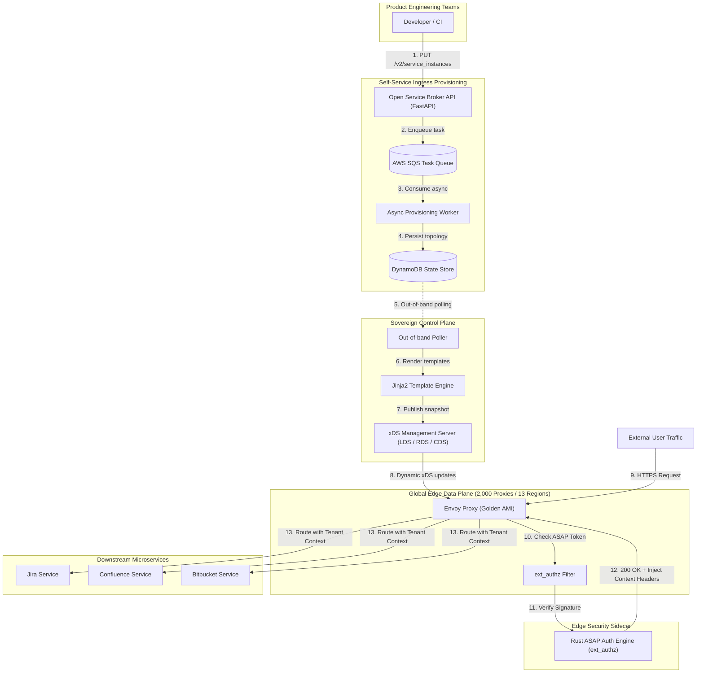

# 🏛️ Sovereign Edge Platform: Architecture & Technical Retrospective

> **Implementation of the edge infrastructure, system design, and institutional knowledge shared by Vasilios Syrakis in *"I was laid off by Atlassian"* ([YouTube 55pTFVoclvE](https://www.youtube.com/watch?v=55pTFVoclvE&t=1115s)).**

---

## 📑 Video Chapter & Concept Mapping

| Timestamp | Video Chapter | Concept Discussed in Video | Implementation in This Project |
|---|---|---|---|
| **04:35 & 07:43** | *Building an Open Service Broker* | Internal self-service provisioning API; decoupling API requests from slow cloud mutations using AWS SQS & DynamoDB. | `services/service_broker/main.py`, `worker.py`, `queue_client.py`, `store.py` |
| **09:56** | *Picking a Proxy Technology (Envoy)* | Transitioning from expensive proprietary load balancers (F5 / AWS ALB limits) to Envoy Proxy for high-throughput, low-latency edge routing. | `services/edge_proxy/envoy-dynamic.yaml`, `docker-compose.yml` |
| **11:36** | *Envoy xDS Control Plane ("Sovereign")* | Custom Envoy management server dynamically rendering templates (Jinja2) for LDS, RDS, CDS without proxy restarts or downtime. | `services/sovereign_control_plane/poller.py`, `templates/`, `main.py` |
| **14:33** | *AWS Infrastructure* | Multi-region VPC architecture across 13 AWS regions managing ~2,000 edge proxies. | `infra/ami_pipeline/multi_region_dist.py` |
| **17:45 (t=1115s)** | *Creating the Machine Image (AMI)* | **Declarative AMI baking (Packer + SaltStack) & booting a live running EC2 test instance in CI to validate the AMI before blessing it.** | `infra/ami_pipeline/packer-edge-proxy.pkr.hcl`, `salt-states/`, `live_ec2_test_harness.py` |
| **24:37 & 25:54** | *Envoy Extensions & Edge Compute* | Offloading cross-cutting auth concerns from microservices to the edge; writing high-performance ASAP token verification filters in **Rust**. | `services/edge_auth_rust/src/main.rs`, `Cargo.toml`, `auth_sidecar_runner.py` |
| **27:12 - 37:11** | *Dev Concerns, Diplomacy & Maintenance* | Building the "Golden Path" for engineering teams; decoupling data plane from control plane resilience; preserving institutional knowledge. | `web-ui/`, `demo.py`, `ARCHITECTURE.md` |

---

## 🌐 High-Level Architecture Diagram

---

## 🔍 Core Pillars Deep Dive

### 1. Self-Service Open Service Broker (OSB)
- **Problem Solved:** Central networking and operations teams were bottlenecks. Developers had to file Jira tickets and wait days for a load balancer route to be created or updated.
- **Solution:** An implementation of the Open Service Broker standard (`/v2/catalog`, `/v2/service_instances`, `/v2/service_bindings`).
- **Decoupled Architecture:** Client requests are immediately accepted (`202 Accepted`) and enqueued in an SQS-compatible task queue. Asynchronous workers drain the queue, validate parameters, assign internal VIPs, and update state in DynamoDB.

### 2. Sovereign: Dynamic Envoy xDS Control Plane
- **Problem Solved:** Proprietary hardware LBs (F5) were expensive, inflexible, and could not dynamically update routing tables for thousands of microservice endpoints without disruptive reloads.
- **Solution:** Envoy Proxy at the edge controlled by **Sovereign**, a custom Python control plane.
- **Template-Based xDS:** Sovereign maintains Jinja2 templates for Envoy resource types (Listeners, Routes, Clusters, Endpoints). Rather than redeploying code, operators update templates or catalog data. Sovereign's out-of-band poller detects changes, renders dynamic JSON, increments the snapshot version (`version_info`), and serves updates to Envoy proxies over HTTP/REST xDS.

### 3. Edge Compute & Rust ASAP Auth Sidecar
- **Problem Solved:** Microservice teams were re-implementing JWT authentication in Ruby, Java, Python, and Node, leading to security vulnerabilities, divergent implementations, and unnecessary GC pauses.
- **Solution:** Atlassian Service Authentication Protocol (ASAP) tokens are validated at the edge using Envoy's `ext_authz` filter calling a high-performance **Rust** sidecar.
- **Outcome:** Sub-millisecond cryptographic verification, zero GC spikes, and automatic injection of verified tenant context headers (`X-Authenticated-Caller`, `X-Tenant-Id`) into downstream requests.

### 4. Declarative AMI Pipeline & Live EC2 Test Harness (Timestamp 1115s)
- **Problem Solved:** Provisioning edge proxies at runtime using Chef/Puppet took 15+ minutes and frequently failed during auto-scaling events due to external repository downtime or network timeouts.
- **Solution:** Golden AMIs baked declaratively with Packer and SaltStack.
- **The Live Test Harness:** As Vasilios highlighted at **18:35 (t=1115s)**:
  > *"We created a little live running EC2 test instance during the build pipeline."*
  
  The build pipeline boots an ephemeral EC2 instance and runs a 7-point automated verification suite:
  1. Envoy binary checksum & build flags
  2. Systemd service lifecycle & auto-restart
  3. Kernel sysctl network tuning (`somaxconn=65535`, `tcp_max_syn_backlog=65535`)
  4. Process open file descriptor limits (`ulimit -n 65536`)
  5. Dynamic xDS control plane connectivity
  6. Admin `/ready` health probe
  7. Security baseline hardening (SSH password disabled, non-root user)
- **Multi-Region Replication:** Only "BLESSED" AMIs are replicated across 13 AWS regions and rolled out with staged canary traffic replacement (5% -> 25% -> 100%).
